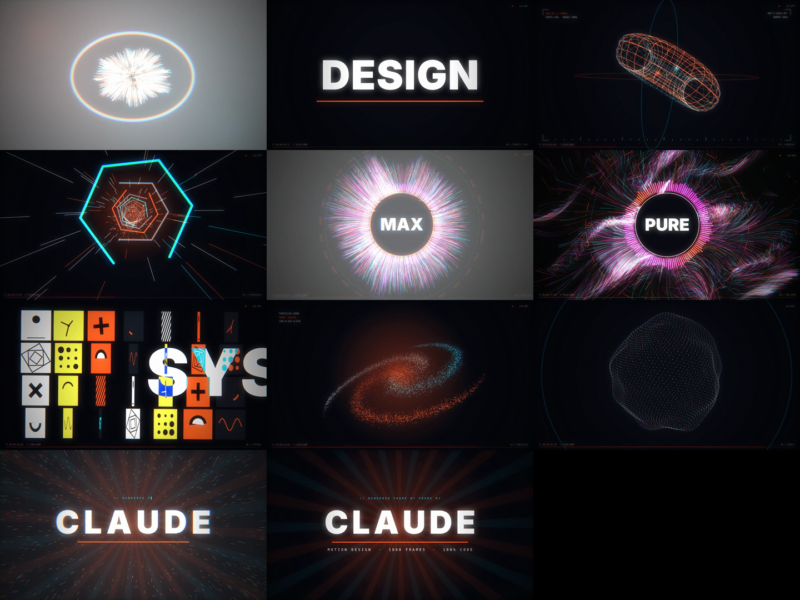

# Motion Design — 30 s, 100% code

`motion.mp4` — 1920×1080, 60 fps, 1800 frames, with a synthesized soundtrack (128 BPM, A minor). No After Effects, no stock footage, no samples: every pixel and every sound is generated by code.



| # | Time | Scene | What it shows |
|---|------|-------|---------------|
| 01 | 0:00 | Ignition | singularity → shockwave → 2600 particles assemble into a word → slice glitch |
| 02 | 0:03.75 | Kinetic type | a new typographic technique on every beat: masks, circle wipe, echo, marquee, text-on-path, decode, zoom into a letter |
| 03 | 0:07.5 | Geometry | parametric wireframes morph sphere → torus → trefoil knot → wave field, HUD |
| 04 | 0:11.25 | Hyperspace | tunnel flythrough, 3-2-1 countdown, one beat of silence |
| 05 | 0:15 | The drop | 3600-particle flow field + beat-reactive visualizer |
| 06 | 0:18.75 | Systems | Swiss grid of 28 looping micro-animations, difference-blend type |
| 07 | 0:22.5 | Particles | 6000 points: galaxy → DNA helix → noise sphere |
| 08 | 0:26.25 | Finale | implosion → boom → signature |

Post: chromatic aberration, bloom, camera shake, glitch slices, flashes, vignette, film grain — all timed to the beat.

## Build

```bash
pip install numpy scipy
./build.sh          # audio.py -> render.mjs (headless Chromium, 4 workers) -> ffmpeg mux
```

- `src/engine.js` — math, easing, noise, 3D projection, text sampling
- `src/scenes.js` — the eight scenes
- `src/post.js` — post-processing stack and HUD
- `audio.py` — soundtrack synthesizer (kick, clap, hats, reese bass, supersaws, risers, impacts, sidechain, reverb)
- Open `src/index.html?preview` in a browser for real-time playback.
